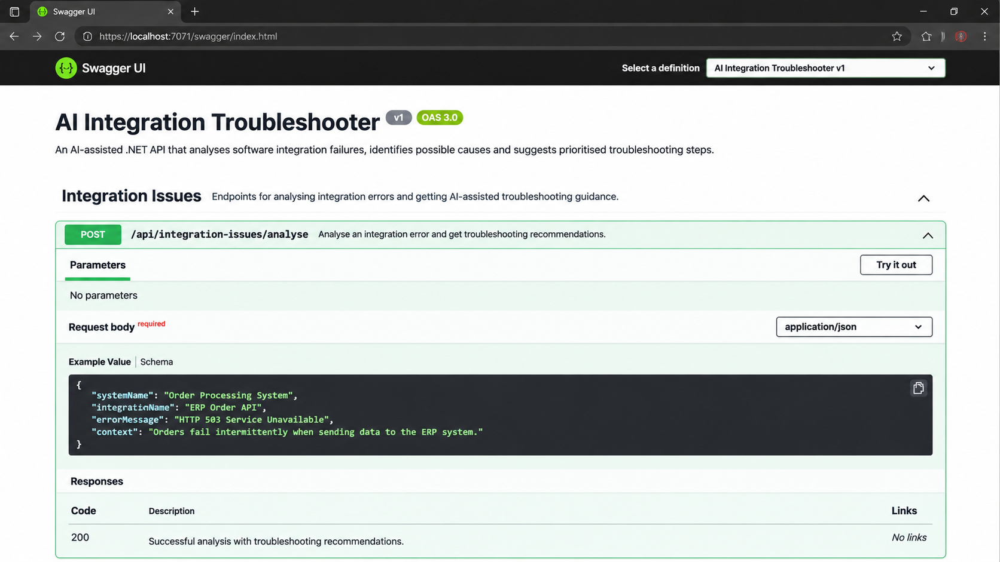
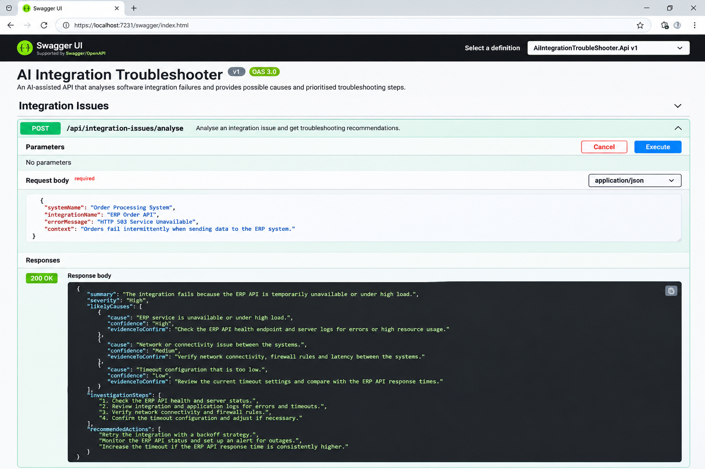

# AI Integration Troubleshooter

An AI-assisted .NET API that analyses software integration failures, identifies possible causes and suggests prioritised troubleshooting steps.

## Features

- AI-assisted analysis of integration errors.
- Ranked possible causes with confidence levels.
- Investigation steps and immediate actions.
- Structured AI responses using JSON.
- API key authentication.
- Input sanitisation.
- Rate limiting and request size limits.
- Timeout and retry handling.
- Automated tests.

## Technology

- C# / .NET 10
- ASP.NET Core Minimal API
- Microsoft.Extensions.AI
- Azure AI Foundry (GPT-5 mini)
- xUnit / Moq

## Architecture

```text
API Endpoint
    |
    v
IntegrationAnalysisService
    |
    v
IAIAnalysisProvider
    |
    +---- Fake Provider
    |
    +---- Azure AI Foundry Provider
```

## Running locally

The application supports a Fake provider for local development without requiring an AI deployment.

```powershell
dotnet run --project AiIntegrationTroubleshooter.Api
```

Run the tests:

```powershell
dotnet test
```

## Azure AI Foundry

The application was successfully tested with a real Azure AI Foundry deployment using GPT-5 mini.

## Purpose

A practical project exploring AI integration in .NET applications, focusing on backend architecture, security, reliability and structured AI responses.

## Screenshots

### API endpoint



### AI analysis response

